# BBS Einbeck iPad Management

[Deutsche Version](README.md)

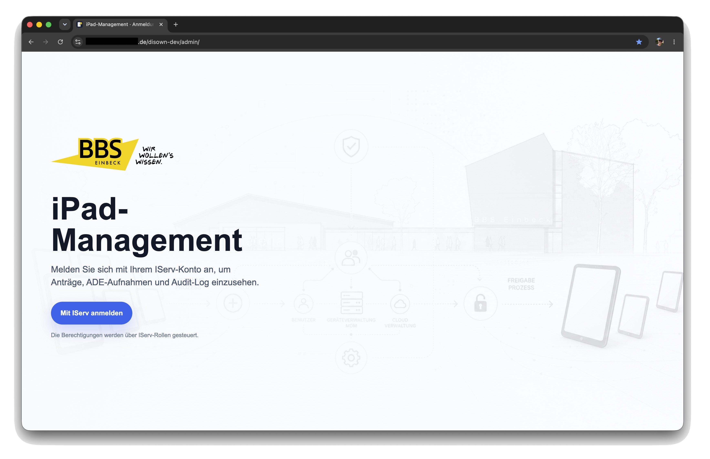

Web application for handling former student iPad returns and releases at BBS Einbeck. DISOWN 2.6 briefly polls Jamf after unenroll; a correctly accepted command may continue to the admin-authorized Apple release while device confirmation is pending. Mail remains manual. A read-only background job reports outstanding Jamf inventory cleanup.

Current rules, migration, cron and tests: [Apple release and Jamf cleanup](docs/DISOWN_2_6_ASYNC_RELEASE.md).

## Status

- Version: `2.6`
- Date: `20 October 2026`
- Production path: `/var/www/sicher.bbs-einbeck.de/disown`
- Development path: `/var/www/sicher.bbs-einbeck.de/disown-dev`
- Public demo: sanitized variant without credentials and without local project-state files

## Features

- Self-service WebClip for release requests.
- Guard page for school-owned loaner/cart devices so they cannot be released accidentally.
- Admin portal with calmer auto-search, status filters, bulk workflow, metrics, rolling 12-month view and Jamf license estimate.
- Admin special release for defective devices by serial number, with explicit single-device review and without bypassing WebClip or bulk safeguards.
- Release broker status including ADE token expiration in the admin dashboard.
- State-based Jamf unenroll with strict response validation, a read-only post-condition, pending/retry handling and reenrollment detection.
- Automated ASM/ADE release through the Apple School Manager Public API and a local NanoDEP release broker.
- Completion mail to school and private email addresses; partial mail failures are shown in red but the request can still be completed.
- The completion-mail template edited in the admin portal is stored in `app_settings` with separate DEV/production keys; the repository file remains only the default fallback.
- Local clarification notes for individual devices.
- KUK device overview for staff iPads from Jamf School.
- ADE intake overview with ASM/ADE and Jamf School comparison.
- Audit log with dashboard, CSV export and recorded bulk serial-number lists.
- DEV mode with demo data and dry-run behavior for Jamf, ASM/ADE and mail.

## Screenshots

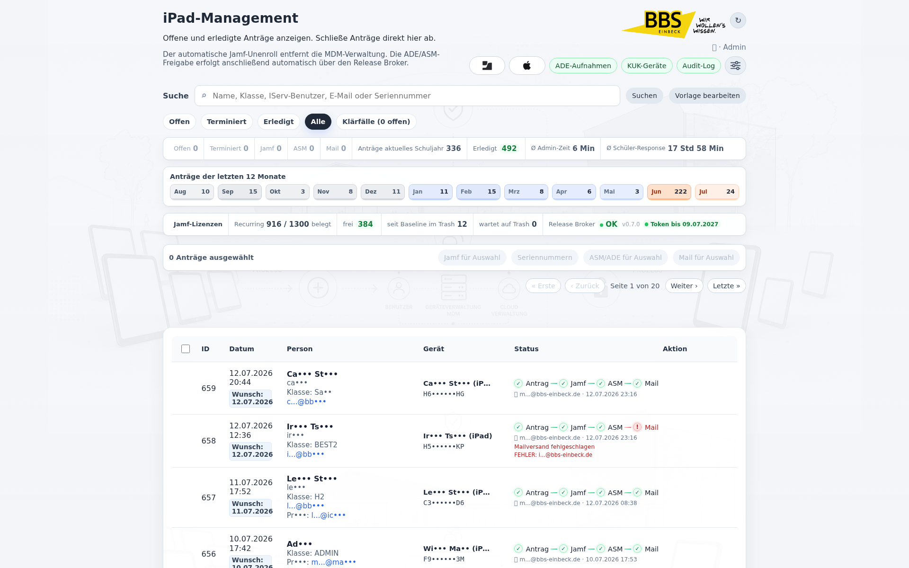

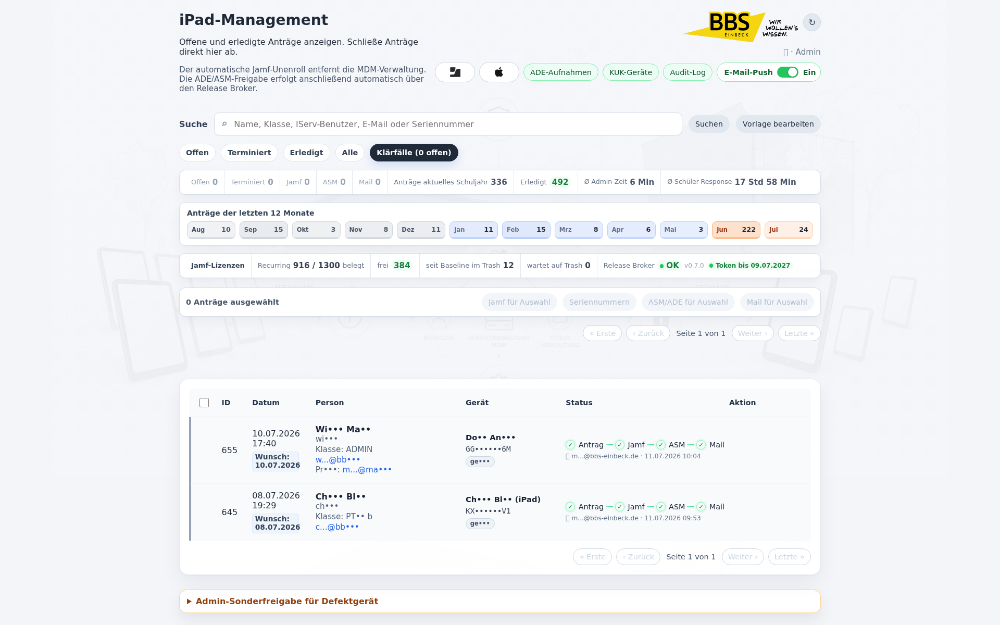

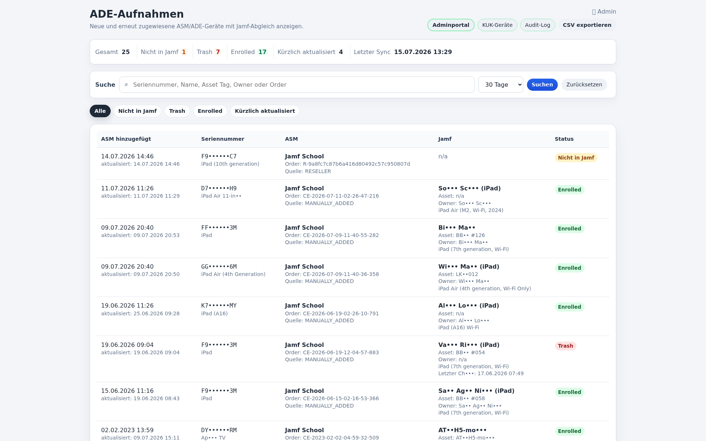

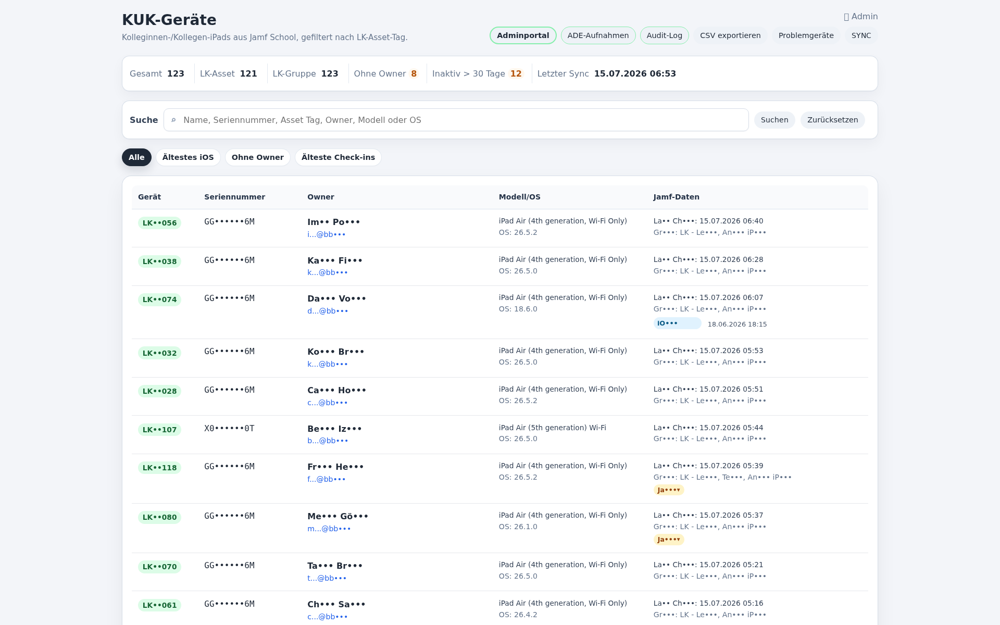

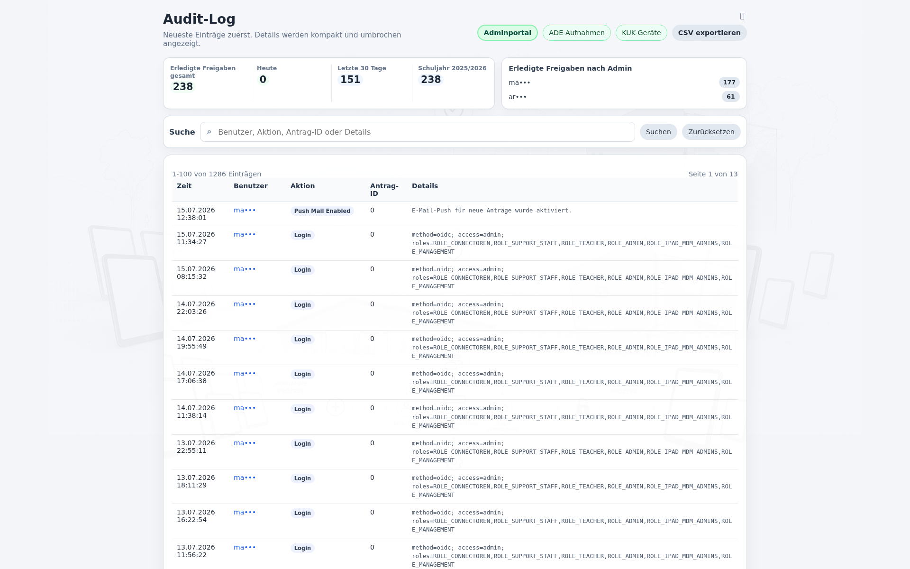

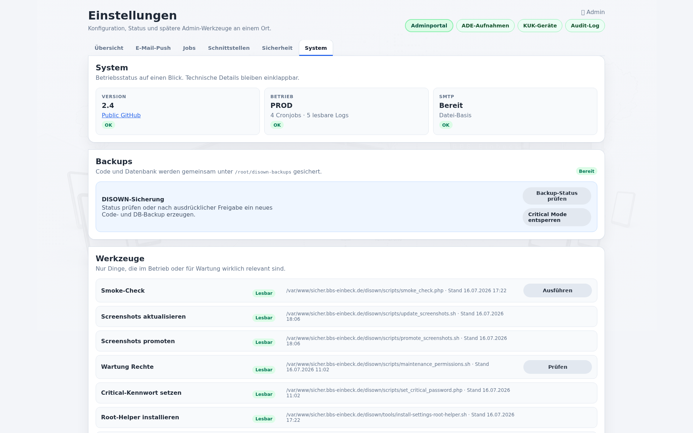

## Mobile Screenshots

<p>
  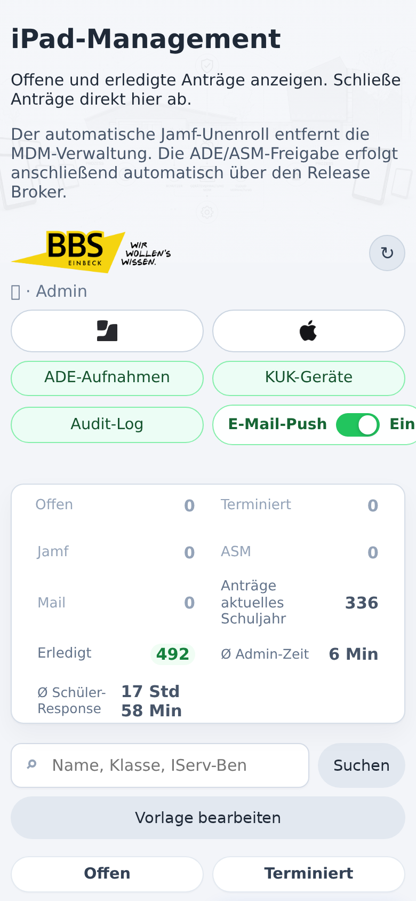
  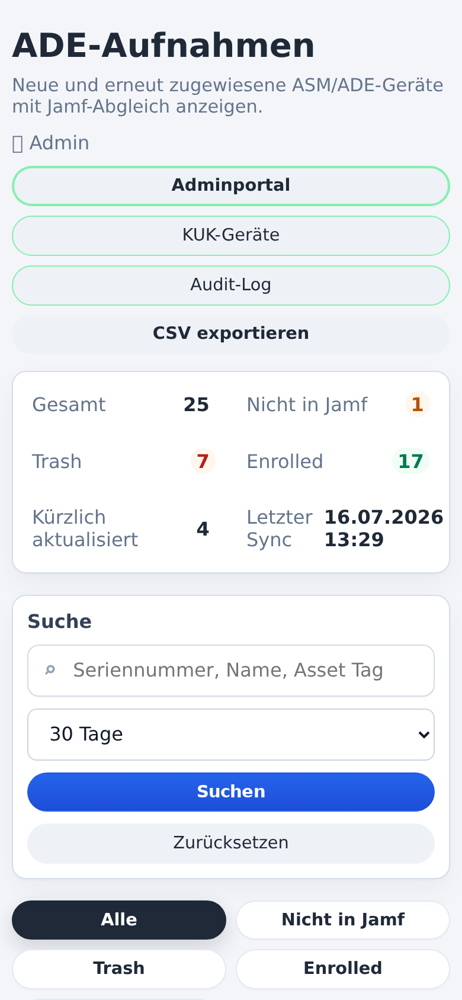
  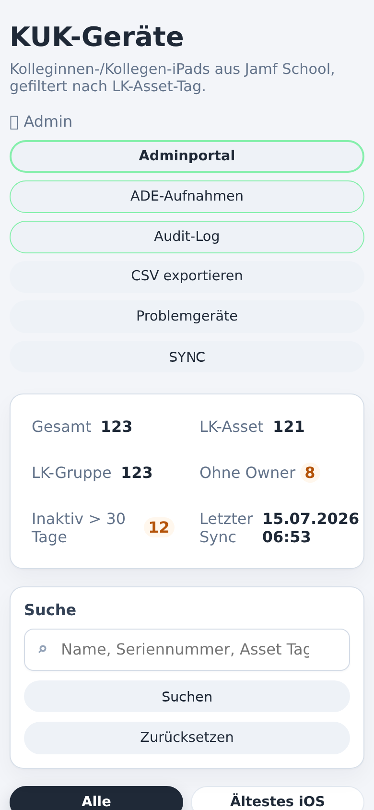
  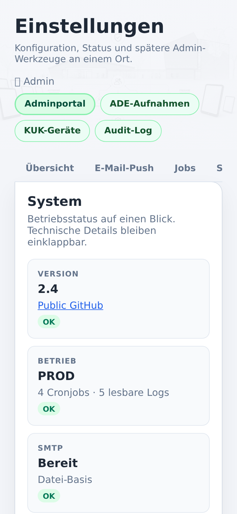
</p>

## Standard Workflow

1. The student submits a request through the WebClip.
2. An admin clicks `Release`: Jamf unenroll followed by up to four brief read-only checks.
3. Verified unenrollment or a correctly accepted command with an unambiguous inventory observation permits the authorized Apple/broker release for that exact device; device silence alone does not block it.
4. The local NanoDEP release broker performs the ADE/DEP disown call.
5. The system verifies that the broker can no longer access the device afterwards.
6. The admin reviews the appropriate mail preview and explicitly confirms sending.
7. The request is completed; partial failures and details are written to the audit log.

The legacy database column `asm_manual_done` is kept for compatibility. Since version 2.0 it means that the ASM/ADE release step has been completed, usually automatically.

## Admin Special Release

The rare special path for defective devices is placed at the bottom of the admin portal above the footer. Admins first check the serial number against Jamf, review the name and mail addresses, and then create only a local request. Jamf unenroll, ASM/ADE release and completion mail continue through the normal table row.

Only this admin-only path may intentionally bypass the school-device blocker. WebClip requests, normal requests and bulk processing remain protected against school-owned loaner/cart devices.

## Bulk Workflow

Bulk processing evaluates every device independently:

1. Select requests.
2. Run `Auswahl freigeben`: brief Jamf checks, then Apple release for verified or correctly accepted cases.
3. Actual failures and ambiguous mappings remain blocked per device; merely waiting devices do not. After confirmed Apple release, the background job reports remaining manual Trash cleanup.
4. `ASM/ADE fuer Auswahl` remains available only as a targeted retry for a previously failed ASM step.
5. Explicitly run `Mail fuer Auswahl` after confirmed Apple release; individual and bulk mail use the same single standard template for all Jamf states.

The selection is kept until the mail step has finished. This prevents admins from losing the selected devices between Jamf, ASM/ADE and mail.

## Version 2.6 Safety Model

- HTTP `200` alone is insufficient: only the expected valid Jamf response confirms command acceptance.
- An active record with `isManaged=false` is considered directly verified.
- Moving from active inventory to trash is not sufficient by itself because trash values such as `lastCheckin` and `isManaged` may be stale.
- Trash alone does not prove profile removal. Fresh correlated evidence may verify Jamf; mere device silence remains pending regardless of click count. Inventory cleanup is tracked separately.
- Up to four short read-only checks immediately after command acceptance detect fast asynchronous completion without another admin click and without sending a second unenroll command.
- Re-enrollment is neither automated nor recommended as a repair path.
- Verified unenrollment or a correctly accepted command with an unambiguous inventory observation permits Apple release. Actual failures remain blocked per device; mail remains manual.
- Delivery errors for obsolete school mailboxes remain visible but do not reopen or stop the completed device workflow.

The decision logic and incident regression scenario are documented in [docs/DISOWN_2_6_BLOCK3_JAMF_VERIFICATION.md](docs/DISOWN_2_6_BLOCK3_JAMF_VERIFICATION.md).

## ASM/ADE Release Broker

Since version 2.0 DISOWN uses two separate Apple paths:

- Apple School Manager Public API: assigns one device to the release-broker MDM service.
- Apple ADE/DEP API through NanoDEP: performs the `disown` call for this device.

Important:

- Releasing a device from the Apple organization is irreversible.
- The broker only listens locally on `127.0.0.1:9001`.
- Secrets live outside the web root under `/srv/disown-protected/asm-release-broker` and `/etc/disown`.
- DEV only performs dry-runs.

Example configuration:

- `config/asm-release-broker.example.conf`

NanoDEP service installer:

- `tools/install-nanodep-service.sh`

## Installation and Operation

See:

- [German: docs/INSTALL.md](docs/INSTALL.md)
- [English: docs/INSTALL.en.md](docs/INSTALL.en.md)

Short version:

1. Provide PHP, MySQL/MariaDB and Apache.
2. Create the database and tables.
3. Configure the Jamf School API.
4. Configure an Apple School Manager API account.
5. Create the ASM release broker service, allow device release and import its token into NanoDEP.
6. Run `tools/install-nanodep-service.sh`.
7. Validate with a DEV dry-run and one single production test device.

### Upgrade from 2.4 to 2.6

After a code and database backup, run the idempotent state migration once:

```bash
php migrations/20261017_add_jamf_unenroll_state.php
php migrations/20261020_add_jamf_cleanup.php
```

Then install the read-only reenrollment cron check and run the 2.6 DEV tests listed in [docs/RELEASE.md](docs/RELEASE.md). The migration classifies legacy rows conservatively and may be run again as an idempotency check.

## Important Files

- `index.php` - WebClip and request intake.
- `admin.php` - admin portal, bulk workflow, mail, dashboards.
- `asm_release.php` - ASM/ADE release through the broker.
- `jamf.php` - Jamf School integration and school-device guard.
- `ade.php` - ADE intake view.
- `kuk/index.php` - KUK devices.
- `audit_log.php` - audit log and reporting.
- `settings.php` - operations, mail, jobs, security and system settings.
- `site.php` - central version, release and footer metadata for every page.
- `config/asm-release-broker.example.conf` - broker runtime configuration example.
- `tools/install-nanodep-service.sh` - systemd setup for the NanoDEP server.
- `tools/install-settings-root-helper.sh` - installs the narrowly scoped Critical Mode root helper.
- `docs/RELEASE.md` - release checklist with backup, smoke and public checks.
- `scripts/smoke_check.php` - read-only smoke check for deployments.

## Security

- No secrets in the repository.
- Runtime configuration lives under `/etc/disown`.
- Tokens and keys live under `/srv/disown-protected`.
- The public repository is sanitized.
- Write actions are admin-only.
- KUK is read-only against Jamf.
- Critical actions are audited.
- Critical Mode expires automatically; the root helper only allows fixed commands.

## History

- `2.6`: verifiable Jamf state machine with pending/retry/manual states, asynchronous completion, safe bulk gating, automatic ASM/ADE continuation only after verification, non-blocking mail failures and read-only reenrollment detection.
- `2.4`: settings portal for email push, SMTP, jobs, security and system operations; Critical Mode protects root-helper actions with a separate password, short lifetime and audit logging.
- `2.4` maintenance: Completely untouched accidental requests can only be deleted from Settings → System → Tools with Critical Mode, request ID and explicit confirmation while retaining an audit record.
- `2.4` maintenance 2026-08-21: Informational push-mail events no longer count as request processing for deletion eligibility. Workflow state, errors, linked cases and every audit action not explicitly allowed still block deletion.
- `2.4` maintenance: Backup status and new code/database backups are available in the settings portal through Critical Mode and the narrowly scoped root helper.
- `2.3`: Switchable email push for new WebClip requests; the admin portal stores the on/off state in `app_settings`, recipients stay in `/etc/disown/notify.conf`.
- `2.2`: Visual release with a polished admin table, selected-row treatment, clearer actions and a unified look for admin, ADE intake, audit log and KUK.
- `2.1`: UI structure modernization; admin, ADE, audit and KUK styles/scripts live in `assets/`, search reacts more calmly and keeps focus after auto-refresh.
- `2.0`: automated ASM/ADE release through the release broker, NanoDEP service, improved bulk workflow, mail to both addresses with partial-success handling, updated docs and screenshots.
- `2.0` maintenance 2026-07-10: admin special release for defective devices, ADE token hint, mail dialog fix and waiting indicator for single actions.
- `1.9`: unified UI, rolling month overview, clarification cases, Jamf license indicator.
- `1.8`: KUK devices, ADE intake, audit dashboard.
